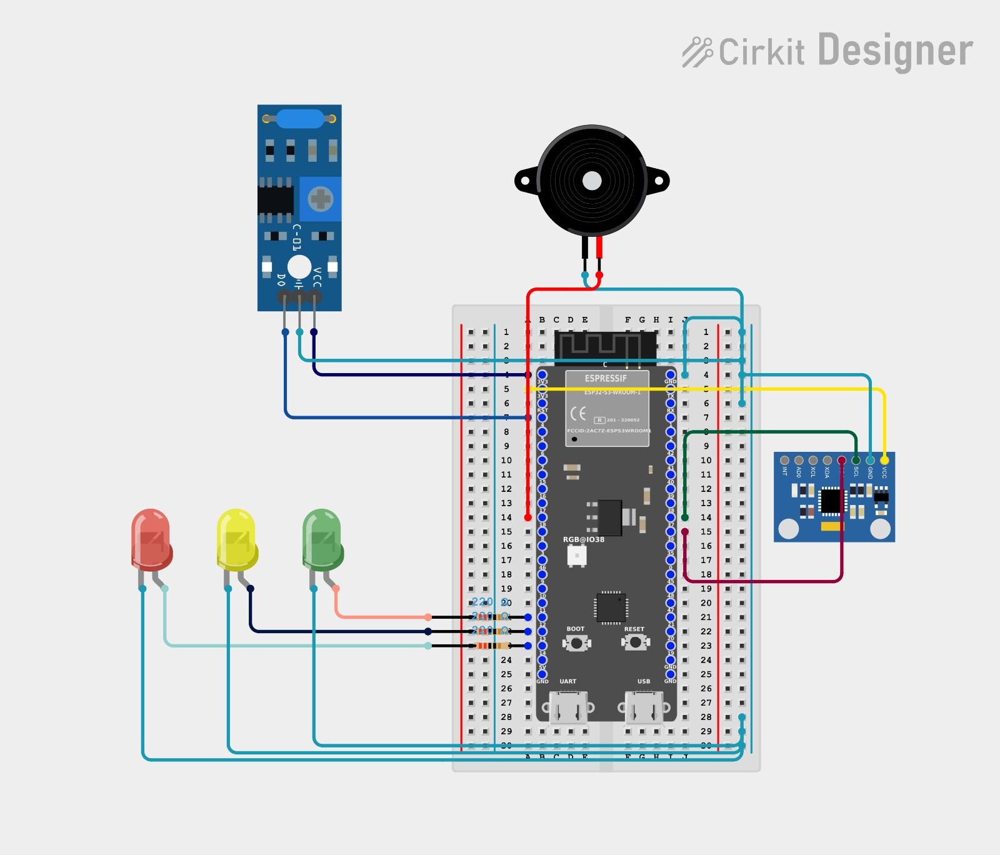

# SUBSENSE

SUBSENSE is a simulated mine-subsidence monitoring research prototype that
collects sensor or simulator telemetry, extracts backend features, and
combines anomaly detection with risk assessment and alerts. It is not a
certified mine-safety system.

> **Frozen-protocol simulation results show simple baselines are competitive on tilt-only cases; the integrated alert rule suppresses some non-tilt anomalies.**

## Status

| Verified | Simulated only | Untested |
|---|---|---|
| AI-engine and backend automated test suites passed for the current change set | Detector evaluation and placeholder CSV data; the placeholder CSV contains 38,700 rows spanning 3,869.9 seconds (1 hour, 4 minutes, 29.9 seconds) | Docker/MQTT/database/dashboard chain |
| In-process FastAPI behaviors covered by tests | Every reported detector result in `docs/evaluation/results.csv` | Datasheet-grounded simulator, literature review, deployment pilot |

## Architecture

Sensors and simulator -> MQTT -> FastAPI backend -> signal processing and
feature extraction -> AI engine (Isolation Forest and baseline deviation) ->
risk engine and alerts -> WebSocket -> Next.js dashboard.

## Hardware design



This is the circuit design for one sensor node.

| Component | Role |
|---|---|
| ESP32-S3-WROOM-1 development board | Microcontroller; reads sensors and publishes telemetry |
| MPU6050 accelerometer/gyroscope module | Tilt and acceleration sensing over I2C |
| SW-420-type vibration sensor module | Digital output for vibration events |
| Piezo buzzer | Audible alert |
| Red, yellow and green LEDs, each with a 220 ohm resistor | SAFE / WARNING / DANGER status indication |

Sensor axes `ax`, `ay` and `az` map to backend telemetry fields `accel_x`,
`accel_y` and `accel_z`; tilt and vibration use `tilt_x`, `tilt_y` and
`vibration` in the backend and AI engine.

The circuit was designed and simulated in Cirkit Designer; this repository
does not contain a `firmware/` folder.

## AI engine

`ai_engine/adapter.py` implements the backend `AnomalyDetector` interface and
maps backend features to the Isolation Forest inputs, including backend
baseline deviation. `backend/app/ml/loader.py` loads the trained model from
`ai_engine/models/isolation_forest.joblib` and falls back to the mock detector
if the model is missing or cannot be loaded.

## Results

The frozen simulation benchmark and its analysis are in
[docs/evaluation/confirmatory_v1/results.csv](docs/evaluation/confirmatory_v1/results.csv)
and [docs/evaluation/CONFIRMATORY_ANALYSIS.md](docs/evaluation/CONFIRMATORY_ANALYSIS.md).
These artifacts compare code-defined methods across the registered scenarios.
The raw Isolation Forest flags some coded non-tilt scenarios, while the
integrated system suppresses many such flags when both tilt and baseline
deviation remain below its alert threshold. Results are specific to the
simulated feature distributions; they do not establish hardware or field
performance. The nuisance-rate endpoint is copied from a shared baseline-drift
control and cannot support per-scenario nuisance-alarm conclusions.

## Known limitations

- All results are from simulation; no hardware recording was used.
- The integrated system's state logic suppresses events that lack tilt change (see 1b); the forest alone detects some of them. A fix would require a new frozen protocol (v2) and is future work.
- Results do not establish field performance. Detector measurements and their
  confidence intervals are in
  [docs/evaluation/confirmatory_v1/results.csv](docs/evaluation/confirmatory_v1/results.csv)
  and [docs/evaluation/CONFIRMATORY_ANALYSIS.md](docs/evaluation/CONFIRMATORY_ANALYSIS.md).
- Vibration and stuck-sensor results are from specialized evaluation baselines,
  not improvements to production detector behavior.
- The final gradual-tilt risk is WARNING, not DANGER.
- Skipped: Docker chain run, datasheet-grounded simulator, literature review,
  and deployment pilot.

## How to run

### Setup

Prerequisites: Python 3.12+ and Docker Desktop for the broker and database
services.

From the repository root, create and activate a virtual environment and
install backend dependencies:

```powershell
python -m venv .venv
.venv\Scripts\Activate.ps1
python -m pip install -r backend\requirements.txt
```

Create the backend environment file:

```powershell
copy backend\.env.example backend\.env
```

Configure a unique random secret for each enrolled node in
`HARDWARE_DEVICE_KEYS` in `backend\.env`, for example
`{"N01":"<unique-random-secret-at-least-32-bytes>"}`. Hardware REST and MQTT
payloads must include a timezone-aware `timestamp`, a unique `nonce` (16–128
allowed characters), and a lowercase HMAC-SHA256 `signature`. The signature is
computed over the canonical JSON payload (sorted keys, compact separators,
UTF-8; omit only the `signature` field), so the timestamp and nonce are signed
along with the telemetry fields. The backend accepts timestamps within 60
seconds of its clock and rejects nonce replay while its process is running.
Only a valid signature can mark a hardware reading LIVE; the source field on
its own is not proof. The simulator forces `source="simulator"` and strips
signature and nonce fields. Use TLS for REST/MQTT and restrict broker access;
HMAC does not replace transport protection or prove physical device identity.

### Docker, backend, simulator, and dashboard

From the repository root, start EMQX and TimescaleDB:

```powershell
docker compose up -d
```

Wait for the services to initialize. EMQX dashboard: http://localhost:18083.

In a new terminal, activate the virtual environment and start the backend:

```powershell
cd backend
..\.venv\Scripts\Activate.ps1
python -m uvicorn app.main:app --reload --host 0.0.0.0 --port 8000
```

Verify the health endpoint at http://localhost:8000/api/health.

In another terminal, run the simulator from its package root:

```powershell
cd simulator
python -m simulator.main --scenario normal
```

Other supported simulator examples:

```powershell
python -m simulator.main --scenario gradual_tilt --duration 120
python -m simulator.main --scenario sensor_failure --dry-run
```

The dashboard is a separate Next.js application. In another terminal:

```powershell
cd dashboard
npm install
npm run dev
```

Open http://localhost:3000.

### Docker-free demo and retraining

From the repository root, run the in-process demo without Docker, MQTT, or
database writes:

```powershell
python scripts/demo_inprocess.py
```

Retrain the model using normal simulator data processed through the backend
feature pipeline:

```powershell
python -m ai_engine.training.train_from_backend
```

### Real sensor recordings

See [docs/data-collection-protocol.md](docs/data-collection-protocol.md) for
the stationary and controlled-event protocol. To capture serial JSON lines,
install optional `pyserial` and run (replace `COM4` with the ESP32's port):

```powershell
python -m pip install pyserial
python tools/log_serial_to_csv.py --port COM4 --baudrate 115200 --output readings.csv
```

Attach reviewed labels with `--label-file labels.csv`. For a stationary CSV,
compute the noise floor and empirical threshold outputs:

```powershell
python -m ai_engine.evaluation.noise_floor readings.csv --output-dir docs/evaluation/real
```

### Tests

Run the AI-engine tests from the repository root:

```powershell
python -m pytest ai_engine/tests -q
```

Run the backend tests from `backend/`:

```powershell
cd backend
python -m pytest -q
```

## Branches and team

- `ai_engine/` is the AI/ML layer.
- `backend/`, `dashboard/` and `simulator/` are the platform components.
- `ai-ml-development` is the submission branch.
