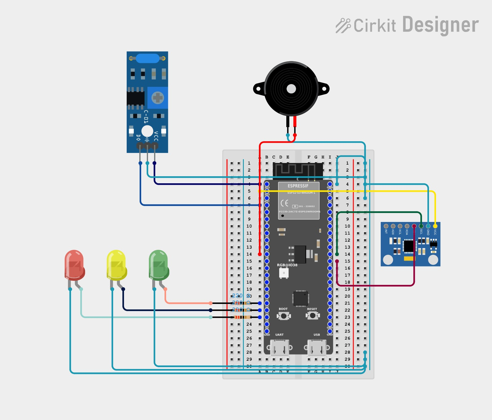

# SUBSENSE

SUBSENSE is a predictive mine-subsidence monitoring research prototype that
collects sensor or simulator telemetry, extracts backend features, and
combines anomaly detection with risk assessment and alerts. It is not a
certified mine-safety system.

## Architecture

Sensors and simulator -> MQTT -> FastAPI backend -> signal processing and
feature extraction -> AI engine (Isolation Forest and baseline deviation) ->
risk engine and alerts -> WebSocket -> Next.js dashboard.

## Hardware design



This is the circuit design for one sensor node.

| Component | Role |
|---|---|
| ESP32-S3-WROOM-1 development board | Microcontroller; reads sensors and publishes telemetry |
| MPU6050 accelerometer/gyroscope module | Tilt and acceleration sensing over I2C |
| SW-420-type vibration sensor module | Digital output for vibration events |
| Piezo buzzer | Audible alert |
| Red, yellow and green LEDs, each with a 220 ohm resistor | SAFE / WARNING / DANGER status indication |

Sensor axes `ax`, `ay` and `az` map to backend telemetry fields `accel_x`,
`accel_y` and `accel_z`; tilt and vibration use `tilt_x`, `tilt_y` and
`vibration` in the backend and AI engine.

The circuit was designed and simulated in Cirkit Designer; this repository
does not contain a `firmware/` folder.

## AI engine

`ai_engine/adapter.py` implements the backend `AnomalyDetector` interface and
maps backend features to the Isolation Forest inputs, including backend
baseline deviation. `backend/app/ml/loader.py` loads the trained model from
`ai_engine/models/isolation_forest.joblib` and falls back to the mock detector
if the model is missing or cannot be loaded.

## Results

Held-out evaluation used seeds 101–103, with 196 feature readings per run.

| Scenario | Result |
|---|---|
| normal | About 93% NORMAL |
| gradual_tilt | About 97% ANOMALOUS |
| multi_node_event | About 97% ANOMALOUS |
| vibration_event | About 59% NORMAL |
| persistent_anomaly | About 100% MICRO_ANOMALY |

Tests: **90 AI-engine + 108 backend, all passing.**

## Known limitations

- Persistent anomalies and isolated vibration events are only weakly detected.
- About 7% of normal readings receive a false `MICRO_ANOMALY` label.
- The model is trained on simulated data only, not real ESP32 readings.
- The final gradual-tilt risk is WARNING (score 45), not DANGER.
- The full Docker + MQTT + dashboard chain was not run end to end.

## How to run

### Setup

Prerequisites: Python 3.12+ and Docker Desktop for the broker and database
services.

From the repository root, create and activate a virtual environment and
install backend dependencies:

```powershell
python -m venv .venv
.venv\Scripts\Activate.ps1
python -m pip install -r backend\requirements.txt
```

Create the backend environment file:

```powershell
copy backend\.env.example backend\.env
```

### Docker, backend, simulator, and dashboard

From the repository root, start EMQX and TimescaleDB:

```powershell
docker compose up -d
```

Wait for the services to initialize. EMQX dashboard: http://localhost:18083.

In a new terminal, activate the virtual environment and start the backend:

```powershell
cd backend
..\.venv\Scripts\Activate.ps1
python -m uvicorn app.main:app --reload --host 0.0.0.0 --port 8000
```

Verify the health endpoint at http://localhost:8000/api/health.

In another terminal, run the simulator from its package root:

```powershell
cd simulator
python -m simulator.main --scenario normal
```

Other supported simulator examples:

```powershell
python -m simulator.main --scenario gradual_tilt --duration 120
python -m simulator.main --scenario sensor_failure --dry-run
```

The dashboard is a separate Next.js application. In another terminal:

```powershell
cd dashboard
npm install
npm run dev
```

Open http://localhost:3000.

### Docker-free demo and retraining

From the repository root, run the in-process demo without Docker, MQTT, or
database writes:

```powershell
python scripts/demo_inprocess.py
```

Retrain the model using normal simulator data processed through the backend
feature pipeline:

```powershell
python -m ai_engine.training.train_from_backend
```

### Tests

Run the AI-engine tests from the repository root:

```powershell
python -m pytest ai_engine/tests -q
```

Run the backend tests from `backend/`:

```powershell
cd backend
python -m pytest -q
```

## Branches and team

- `ai_engine/` is the AI/ML layer.
- `backend/`, `dashboard/` and `simulator/` are the platform components.
- `ai-ml-development` is the submission branch.
